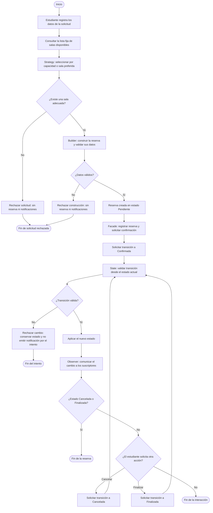

# Estación 1: análisis del sistema de reservas de biblioteca

## Objetivo y alcance

Comprender el caso de uso, representar su flujo y separar responsabilidades antes de programar. Este documento se basa en las instrucciones de la estación 1 proporcionadas por el estudiante. No implementa clases Java ni estaciones posteriores.

La biblioteca Espacio de Estudio ofrece las siguientes salas:

| Sala | Capacidad máxima |
| --- | ---: |
| A | 2 personas |
| B | 4 personas |
| C | 6 personas |
| D | 8 personas |

La solicitud contiene identificador y nombre del estudiante, fecha, hora de inicio, duración en horas, cantidad de personas y criterio de selección. Si el criterio es sala preferida, también debe identificarse esa sala.

La disponibilidad se representa mediante una lista fija. El almacenamiento es simulado: no hay base de datos, calendario real ni control de solapamientos de horarios.

## Reglas y análisis del proceso

1. El estudiante registra los datos de la solicitud.
2. El sistema consulta la lista fija de salas disponibles.
3. La estrategia de selección busca una sala disponible con capacidad suficiente. Por capacidad, elige la de menor capacidad que satisfaga la solicitud. Por sala preferida, elige únicamente esa sala si está disponible y tiene capacidad suficiente; no sustituye la preferencia por otra sala.
4. Si no encuentra una sala adecuada, rechaza la solicitud y termina sin construir ni registrar una reserva y sin notificar a suscriptores.
5. Builder reúne los datos, valida la construcción y entrega una reserva en estado Pendiente. Si los datos no son válidos, la construcción se rechaza y no se registra una reserva ni se emiten notificaciones. Esta estación identifica la responsabilidad de validar; no añade reglas sobre fechas, horarios o límites de duración que no se hayan especificado.
6. Facade registra la reserva y después coordina el intento de confirmación.
7. State comprueba la transición solicitada. Si es válida, se aplica el nuevo estado. Si es inválida, se conserva el estado y no se genera ninguna notificación por ese intento.
8. Observer comunica a los suscriptores únicamente los cambios de estado aceptados.
9. El estudiante puede solicitar cancelar o finalizar la reserva. Estas acciones vuelven a pasar por State y, solo si cambian el estado, por Observer.

Ejemplos de selección: para 3 personas, si todas las salas están disponibles, el criterio por capacidad elige B. Para 5 personas con preferencia por B, se rechaza la solicitud porque B solo admite 4 personas. Para 9 personas, ninguna sala es adecuada.

### Estados y transiciones permitidas

| Estado actual | Acción | Estado resultante |
| --- | --- | --- |
| Pendiente | Confirmar | Confirmada |
| Pendiente | Cancelar | Cancelada |
| Confirmada | Cancelar | Cancelada |
| Confirmada | Finalizar | Finalizada |

Cualquier otra transición se rechaza sin modificar el estado ni emitir notificaciones. Cancelada y Finalizada son estados terminales. La creación en Pendiente no equivale a una confirmación.

En el recorrido normal, Facade intenta confirmar inmediatamente después del registro, por lo que la siguiente acción del estudiante parte de Confirmada. La cancelación desde Pendiente sigue siendo una transición válida del modelo, aunque no sea una pausa interactiva del recorrido normal. No se añade un menú ni un caso de uso separado para forzarla.

## Diagrama de flujo

Los terminales redondeados representan inicio y fin, los rectángulos representan procesos y los rombos representan decisiones. El fin de una interacción no cambia por sí mismo el estado de la reserva.

El archivo [flujo-reservas.mmd](diagramas/flujo-reservas.mmd) contiene el mismo diagrama sin el bloque Markdown.

## Responsabilidades que deben separarse de Main

Los siguientes elementos son responsabilidades de diseño, no declaraciones de nuevas clases ni implementaciones de estaciones posteriores.

| Responsabilidad | Qué debe resolver | Relación con los patrones |
| --- | --- | --- |
| Representación de estudiantes | Mantener el identificador y nombre del solicitante. | Datos del dominio usados al construir la reserva; no requiere uno de los cinco patrones. |
| Representación de salas | Mantener la identificación y capacidad de cada sala. | Datos del dominio consultados por Strategy. |
| Construcción y validación de reservas | Reunir los datos requeridos y entregar una reserva válida en Pendiente, o rechazar su construcción. | Builder concentra la construcción y sus validaciones. |
| Selección de salas | Aplicar el criterio por capacidad o por sala preferida sobre las salas disponibles. | Strategy permite cambiar el criterio sin mezclar ambos algoritmos en Main. |
| Consulta y almacenamiento simulado | Proporcionar la lista fija de salas disponibles y almacenar las reservas registradas en memoria. | Colabora con Strategy y Facade; no necesita añadir otro patrón al laboratorio. |
| Coordinación del caso de uso | Registrar la reserva construida y coordinar el intento de confirmación después del registro. | Facade ofrece un punto de entrada para coordinar el proceso. |
| Control de estados | Validar y aplicar las transiciones permitidas, rechazando las demás. | State concentra el comportamiento que depende del estado actual. |
| Notificaciones a suscriptores | Comunicar cambios de estado aceptados a quienes estén suscritos. | Observer separa a la reserva de los receptores concretos de sus avisos. |

Main debe limitarse al arranque y a conectar o invocar los componentes necesarios. Las reglas de selección, construcción, transición y notificación deben quedar en los componentes responsables.

## Pregunta de comprobación

**¿Por qué una clase Main que consulta salas, valida datos, construye reservas, notifica y controla estados tendría baja cohesión y sería difícil de mantener?**

Una clase así incumpliría el principio de responsabilidad única porque tendría varios motivos independientes para cambiar: modificar el criterio de selección, ajustar la construcción de reservas, cambiar el almacenamiento simulado, agregar un suscriptor o revisar una transición de estado.

Tendría baja cohesión porque agruparía tareas con propósitos distintos. La cohesión expresa qué tan relacionadas están las responsabilidades internas de un componente: representar el arranque de la aplicación no tiene el mismo propósito que decidir si una reserva puede finalizar.

También aumentaría el acoplamiento de Main con los detalles de selección, almacenamiento, estados y notificaciones. Una modificación en uno de esos detalles obligaría a revisar código que además realiza otras tareas, aumentando el riesgo de afectar comportamientos que ya funcionaban.

La separación de responsabilidades permite que Builder atienda la construcción, Strategy la selección, Facade la coordinación, State las transiciones y Observer las comunicaciones. Así cada componente tiene un propósito definido y sus cambios quedan más localizados.

Para probar una Main que concentra todo, sería necesario preparar datos, salas, estados y suscriptores incluso al comprobar una sola regla. Con responsabilidades separadas se puede comprobar, por ejemplo, la selección para 3 personas o el rechazo de Finalizada a Confirmada de forma aislada. Esto facilita localizar errores y mantener el sistema sin tener que ejecutar todo el flujo en cada comprobación. Estos son ejemplos de pruebas futuras, no pruebas de Java ejecutadas en esta estación.

## Validaciones realizadas y pendientes

Se ejecutaron las siguientes comprobaciones sobre los archivos de esta entrega:

- Rama activa: `estacion-01`, todavía sin commit inicial.
- Sintaxis del diagrama aceptada por el parser de Mermaid 11.17.2 como `flowchart-v2`. La herramienta de validación se instaló en una carpeta temporal externa al repositorio.
- Coincidencia exacta entre el diagrama del Markdown y el archivo `.mmd`.
- Comprobación automatizada de las conexiones del flujo: los rechazos por falta de sala o datos inválidos terminan sin alcanzar la creación, el registro ni Observer; el rechazo de una transición termina sin aplicar ni notificar ese cambio.
- Comprobación automatizada del orden del recorrido principal, la presencia de los cinco patrones y el retorno de cancelar/finalizar a State.
- Estructura de entrega: únicamente los dos archivos solicitados y ningún archivo Java.
- Revisión del contenido: ocho responsabilidades diferenciadas, cuatro transiciones permitidas y alcance limitado a la estación 1.

Quedan pendientes la revisión visual del diagrama en el visor Mermaid que se utilizará para la sustentación y las capturas reales indicadas a continuación. La validación sintáctica no equivale a una inspección visual del renderizado. No se ejecutaron pruebas funcionales Java porque no hay implementación en esta estación. No se realizaron commits ni push.

## Evidencias reales para la sustentación

| Nombre recomendado | Ventana o contenido que debe aparecer | Momento de la captura | Qué demuestra |
| --- | --- | --- | --- |
| `01-rama-estacion-01.png` | Terminal situada en la raíz del repositorio con `git branch --show-current` y `git status --short --branch`. | Al revisar la entrega, antes de registrar cambios. | Rama activa y estado real del trabajo. Si aún no hay commits, ese mensaje es esperado. |
| `02-estructura-estacion-1.png` | Explorador del editor con `docs/estacion-1.md` y `docs/diagramas/flujo-reservas.mmd` visibles. | Después de guardar ambos archivos. | Organización de la estación 1 y ausencia de clases Java en esta entrega. |
| `03-flujo-reservas-general.png` | Vista previa Mermaid del Markdown o del archivo `.mmd`, con el flujo completo. | Después de abrir una vista previa compatible y comprobar que se renderiza. | Orden general y participación de los cinco patrones. |
| `04-flujo-rechazo-y-estados.png` | Vista ampliada del rechazo por falta de sala y de las ramas de State y Observer. Si no caben legibles, tomar dos capturas con sufijos `-a` y `-b`. | Durante la revisión del diagrama. | Rechazo sin reserva, control de transiciones y notificación solo tras cambios válidos. |
| `05-responsabilidades-y-comprobacion.png` | Vista previa del documento con la tabla de responsabilidades y la respuesta de comprobación; usar dos capturas si es necesario. | Al terminar la revisión del análisis. | Separación de responsabilidades y explicación de cohesión, acoplamiento y mantenimiento. |

Las capturas deben tomarse directamente de las ventanas reales. No se requiere evidencia de ejecución Java, pues esta estación solo entrega análisis y modelado. La vista previa depende de que el editor o visor admita Mermaid.
